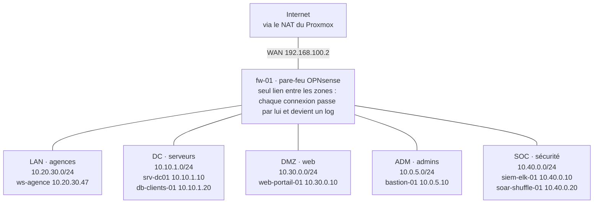

# Visite guidée du lab SOC Azur Bank

Mis à jour le 7 novembre 2026.

Ce guide explique avec des mots simples comment notre SOC repère et bloque une fuite de données clients. Lisez-le dans l'ordre : chaque étape s'appuie sur la précédente, et chaque mot technique est expliqué la première fois qu'il apparaît. Comptez 30 à 45 minutes, commandes comprises.

## L'histoire en une minute

Le 6 novembre à 18:16, le compte `c_dupont` lit 600 fiches clients une par une, puis copie toute la table d'un coup. Notre SOC l'a repéré en 15 secondes et a bloqué le compte 50 secondes plus tard, sans qu'un humain intervienne. Tout ce guide sert à comprendre comment.

Azur Bank est une banque fictive de 1 500 personnes. Sa base `core_clients` contient 5 000 clients avec leur nom, leur IBAN et leur solde. Notre scénario, imposé par l'énoncé, est l'exfiltration de ces données : quelqu'un les sort de la banque, avec un compte qui a pourtant le droit de les lire.

**L'analogie à garder en tête : l'alarme d'une agence bancaire.**

| Dans une agence | Dans notre lab | Le mot technique |
| --- | --- | --- |
| Les caméras dans chaque pièce | Un petit programme sur chaque machine qui lit ses journaux | Elastic Agent |
| Le chef de la sécurité qui dit à chaque caméra quoi filmer | La console qui configure tous les agents à distance | Fleet |
| Les enregistrements classés par pièce et par heure | Les journaux rangés dans des champs aux noms communs | Ingest pipeline, ECS |
| La salle de contrôle avec ses écrans | Le serveur qui stocke tout et permet de chercher | SIEM (Elasticsearch + Kibana) |
| Le détecteur qui sonne si quelqu'un reste 10 minutes devant le coffre | Une règle qui compte les lectures sur 10 minutes | Règle de détection |
| Le vigile qui ferme les portes dès que l'alarme sonne | Un robot qui bloque le compte et ouvre un dossier | SOAR (Shuffle) |
| Le rapport écrit pour la direction le lendemain | Le dossier d'incident et le tableau de bord | Case, ticket 5W, dashboard |

Le reste du guide suit exactement cet ordre.

## Le trajet d'un log

Un log fait toujours le même chemin. Si vous retenez ce schéma, vous savez à quoi sert chaque outil du projet.

```mermaid
flowchart LR
    subgraph A["Collecter et ranger (étapes 2 et 3)"]
        direction LR
        m1["1. La machine écrit<br/>PostgreSQL note chaque lecture"] --> m2["2. L'agent ramasse<br/>Elastic Agent l'envoie au SIEM (Fleet)"]
        m2 --> m3["3. Le pipeline trie<br/>découpe la ligne en champs ECS"]
        m3 --> m4["4. Le SIEM stocke<br/>Elasticsearch, dans logs-db.audit"]
    end
    subgraph B["Détecter et réagir (étapes 5 à 8)"]
        direction LR
        m5["5. La règle compte<br/>chaque minute : 500 lectures en 10 min ?"] --> m6["6. L'alerte sonne<br/>dans Kibana Alerts, avec sa gravité"]
        m6 --> m7["7. Shuffle confine<br/>case ouvert, compte bloqué en 50 s"]
        m7 --> m8["8. L'humain enquête<br/>case, ticket 5W, rapport, dashboard"]
    end
    m4 --> m5
```



Si un maillon casse, tout ce qui suit s'arrête : c'est la meilleure façon de dépanner, en remontant la chaîne.

## Le vocabulaire

Revenez à ces quatre tableaux dès qu'un mot bloque. Ils suivent l'ordre du guide : l'infrastructure, puis la collecte, la détection et la réponse.

**L'infrastructure**

| Mot | Ce que c'est | Chez nous |
| --- | --- | --- |
| Log (journal) | Une ligne de texte qu'un programme écrit à chaque action : qui, quoi, quand | Une ligne de PostgreSQL par lecture de la table `clients` |
| SOC | Security Operations Center : l'équipe et les outils qui surveillent le SI jour et nuit | Notre projet : un SOC pour Azur Bank |
| Proxmox | Un logiciel qui fait tourner plusieurs machines virtuelles sur un seul serveur physique | Le serveur OVH qui héberge tout le lab |
| VM et conteneur (LXC) | Une VM simule un ordinateur complet. Un conteneur est plus léger : il partage le noyau Linux de l'hôte | Windows et le SIEM sont des VM, la base et le bastion sont des conteneurs |
| `qm` et `pct` | Les deux commandes Proxmox : `qm` pilote les VM, `pct` pilote les conteneurs | `pct exec 212 -- ls` lance `ls` dans le bastion |
| Bridge (`vmbr`) | Un switch virtuel. Les machines branchées sur le même bridge sont dans le même réseau | `vmbr3` = la zone Datacenter |
| Zone réseau | Un réseau séparé des autres, comme une pièce à badge | LAN (agences), DC (serveurs), DMZ (site web), ADM (admins), SOC |
| DMZ | La zone exposée à Internet, isolée pour qu'une attaque ne touche pas le reste | Le portail web client |
| Pare-feu | La machine qui laisse passer ou bloque chaque connexion entre zones, selon des règles | fw-01 (OPNsense) |
| Bastion | Le seul point d'entrée autorisé pour administrer les serveurs sensibles | bastion-01, seul chemin vers la base |
| Active Directory (AD) | L'annuaire Windows des comptes et des machines de l'entreprise | srv-dc01, domaine `azurbank.local` |

**La collecte**

| Mot | Ce que c'est | Chez nous |
| --- | --- | --- |
| SIEM | Security Information and Event Management : l'outil qui centralise les logs, les range, permet de chercher et lève des alertes | Elastic Security sur siem-elk-01 |
| Elasticsearch | La base de données du SIEM : elle stocke les logs et les retrouve très vite | Port 9200 de siem-elk-01 |
| Kibana | L'interface web d'Elastic : recherche, règles, alertes, dashboards | https://localhost:5601 (voir plus bas) |
| Elastic Agent | Un programme installé sur chaque machine. Il lit les logs et les envoie au SIEM | 5 agents, un par machine du lab |
| Fleet et Fleet Server | Fleet est la page de Kibana qui gère les agents. Fleet Server est le service auquel les agents se connectent pour recevoir leurs consignes | Port 8220 de siem-elk-01 |
| Politique d'agent | La liste des consignes d'un agent : quels fichiers lire, quoi envoyer | `pol-linux-db`, `pol-windows`... |
| Intégration | Un module prêt à l'emploi qui sait lire un type de log | Nginx, System, Windows, pfSense |
| Ingest pipeline | Une suite de traitements appliquée à chaque log avant de le stocker, pour le découper en champs | `db-audit-pgaudit` |
| ECS | Elastic Common Schema : une liste de noms de champs communs à toutes les sources. `user.name` veut toujours dire « le compte » | `user.name : c_dupont` partout |
| Data stream | L'endroit où sont rangés les logs d'un même type, nommé `logs-<type>-<espace>` | `logs-db.audit-default` |
| Logstash | Un outil de transformation plus puissant qu'un pipeline, pour les sources sans intégration toute faite | La passerelle SWIFT |
| pgaudit | Une extension de PostgreSQL qui écrit un log pour chaque lecture ou écriture | Sur db-clients-01 |
| Sysmon | Un outil Microsoft qui trace en détail ce qui se passe sur un Windows : processus lancés, connexions | Sur srv-dc01 et ws-agence |
| EDR (Elastic Defend) | Un antivirus nouvelle génération qui observe le comportement des programmes | Sur les deux Windows |

**La recherche et la détection**

| Mot | Ce que c'est | Chez nous |
| --- | --- | --- |
| Discover | La page de Kibana pour lire et filtrer les logs, comme un moteur de recherche | Kibana > Discover |
| KQL | Kibana Query Language : un filtre simple, événement par événement | `user.name : "c_dupont"` |
| EQL | Event Query Language : décrit un enchaînement dans le temps, « A puis B » | 100 lectures puis un export |
| ES\|QL | Un langage façon SQL, avec des tuyaux `\|`, pour compter et calculer | Compter les lectures puis vérifier l'export |
| Règle de détection | Une recherche que le SIEM relance tout seul, par exemple chaque minute. Si elle trouve quelque chose, elle crée une alerte | « Lecture massive base clients » |
| Règle Threshold (seuil) | Une règle qui compte et sonne au-delà d'un nombre | 500 lectures ou plus en 10 min |
| Building block | Une alerte « brique », cachée par défaut, qui sert de preuve à une alerte principale | Les 100 lectures d'une séquence EQL |
| SIGMA | Un format standard pour écrire une règle une fois et la convertir pour n'importe quel SIEM | Les fichiers `.yml` du dossier `sigma/` |
| MITRE ATT&CK | Le catalogue mondial des techniques d'attaque, chacune avec un code | T1530, TA0010 |

**La réponse**

| Mot | Ce que c'est | Chez nous |
| --- | --- | --- |
| Alerte | Ce que crée une règle quand elle trouve quelque chose. Elle a une gravité et un statut (ouverte, acquittée, close) | Security > Alerts |
| Case | Le dossier d'incident dans Kibana : on y attache les alertes et on y écrit l'enquête | Security > Cases |
| Ticket 5W | Le résumé d'un incident en cinq questions : qui, quoi, où, quand, pourquoi | INC-2026-11-06-001 |
| SOAR | Security Orchestration, Automation and Response : un outil qui exécute la réponse automatiquement | Shuffle |
| Playbook (workflow) | La recette de réponse : une suite d'étapes que le SOAR déroule | 4 étapes, lancées chaque minute |
| Confinement | Couper l'accès de l'attaquant sans tout éteindre | Compte bloqué dans la base et dans l'AD |
| MTTD et MTTR | Temps moyen pour détecter (Detect) et pour réagir (Respond). Plus c'est court, mieux c'est | 15 s et 50 s sur l'incident du 6/11 |
| Licence Basic | La version gratuite et sans date de fin d'Elastic. Pas de machine learning, pas de webhook | Notre SIEM on-prem |
| Hybride | Une partie chez soi (on-prem), une partie dans le cloud | SIEM sur Proxmox + projet Elastic Cloud |

## Le plan du lab

Le lab imite une vraie banque découpée en zones, comme un bâtiment où chaque étage demande un badge différent. Tout tourne sur un seul serveur Proxmox. Les schémas détaillés sont dans [`schemas/`](schemas/) (`lab-proxmox.png`, `architecture-hybride.png`).



Règles clés : le LAN ne joint pas la base clients. Seule la zone ADM (le bastion) y accède, en 5432 et 22. Les zones envoient leurs logs au SOC (8220, 9200). Le SOC n'ouvre aucune connexion vers elles.

La zone SOC a été ajoutée le 6 novembre : depuis, le SIEM tourne chez nous en licence Basic, gratuite et sans date de fin. Le projet Elastic Cloud (essai jusqu'au 19 novembre) sert seulement à illustrer la partie Cloud de l'architecture hybride.

| ID Proxmox | Machine | Son rôle en une phrase | Type |
| --- | --- | --- | --- |
| 200 | fw-01 | Le pare-feu OPNsense qui relie et filtre les zones | VM |
| 201 | srv-dc01 | L'annuaire Active Directory `azurbank.local` | VM Windows Server |
| 202 | ws-agence | Le poste d'un conseiller en agence, joint au domaine | VM Windows 11 |
| 210 | db-clients-01 | La base PostgreSQL des 5 000 clients, surveillée par pgaudit | Conteneur |
| 211 | web-portail-01 | Le site web des clients (nginx) | Conteneur |
| 212 | bastion-01 | Le passage obligé des admins vers les serveurs, et le collecteur des logs du pare-feu | Conteneur |
| 220 | siem-elk-01 | Le SIEM : Elasticsearch, Kibana, Fleet Server et Logstash | VM |
| 221 | soar-shuffle-01 | Le SOAR Shuffle, qui exécute la réponse automatique | VM |

L'ID sert dans les commandes Proxmox : `pct exec 212` vise le bastion, `qm terminal 200` le pare-feu.

## Avant de toucher au lab

Tout passe par le serveur Proxmox. Les machines du lab n'ont pas d'adresse visible depuis Internet : on entre d'abord sur le Proxmox, puis on rebondit vers la machine voulue.

1. **Se connecter au Proxmox.** Il faut être sur le réseau Tailscale du groupe et avoir sa clé SSH chargée (`ssh-add`). Ensuite : `ssh root@100.106.21.10`.
2. **Lancer une commande dans un conteneur Linux** (base, portail, bastion) : `pct exec <ID> -- <commande>`. Exemple : `pct exec 212 -- whoami` répond `root`, depuis le bastion.
3. **Ouvrir une VM** (Windows, pare-feu, SIEM, SOAR) : par la console web Proxmox (https://100.106.21.10:8006), ou `qm terminal 200` pour la console texte du pare-feu (on en sort avec Ctrl+O).
4. **Ouvrir Kibana.** Kibana n'est joignable que depuis le Proxmox. On crée donc un tunnel SSH : sur votre PC, `ssh -L 5601:10.40.0.10:5601 root@100.106.21.10`, laissez la fenêtre ouverte, puis ouvrez https://localhost:5601. Le navigateur affiche un avertissement de certificat : c'est normal, le certificat est signé par la CA interne du SOC.
5. **Ouvrir Shuffle** (le SOAR), même principe : `ssh -L 3443:10.40.0.20:3443 root@100.106.21.10`, puis https://localhost:3443.
6. **Avoir un shell sur le SIEM** : `ssh -J root@100.106.21.10 jakub@10.40.0.10`, puis `sudo -i`.

**Les accès.** Les mots de passe sont uniquement dans le fichier `mots-de-passe-lab.xlsx`, du dossier « Accès lab (confidentiel, ne pas partager) ». Ce dossier est exclu de git : ne le copiez jamais dans un livrable, un chat ou une capture. Pour les scripts qui parlent à Elastic, la clé API se met dans une variable du terminal (`export ES_API_KEY=...`), jamais dans un fichier.

**Pourquoi un tunnel ?** C'est la logique bancaire : la console du SIEM ne doit pas être exposée. Le tunnel fait passer votre navigateur par le Proxmox, comme si vous étiez dans la salle serveur.

## Étape 1 · Isoler les zones avec le pare-feu

**Pourquoi.** Une banque ne laisse pas un poste d'agence parler directement à la base clients. Si un poste est infecté, l'attaquant reste coincé dans sa zone. Les normes PCI DSS et SWIFT CSP exigent ce cloisonnement.

**Comment ça marche.** Chaque zone est un bridge Proxmox sans adresse IP : l'hôte ne fait pas passer le trafic d'une zone à l'autre. Seul fw-01 est branché sur toutes les zones, il est donc obligé de voir chaque connexion. Ses règles principales :

- le LAN (agences) ne peut pas joindre la base clients ;
- seule la zone ADM (le bastion) peut joindre la base, en 5432 (PostgreSQL) et 22 (SSH) ;
- les zones LAN, DC et DMZ peuvent envoyer leurs logs au SIEM (ports 8220 et 9200), mais le SIEM ne peut rien ouvrir vers elles : il reçoit, il n'initie rien ;
- vers Internet, seulement le web (80 et 443).

Chaque décision du pare-feu est elle-même un log, envoyé au bastion puis au SIEM. Le pare-feu est donc aussi une source de détection.

**À essayer.**

1. Depuis le bastion (zone ADM), la base répond : `pct exec 212 -- ping -c1 10.10.1.20`.
2. Depuis le portail web (zone DMZ), elle ne répond pas : `pct exec 211 -- ping -c1 -W2 10.10.1.20`.
3. Dans Kibana > Discover, choisissez la vue `logs-pfsense.log-*` et tapez `event.action : block`.

**Ce que vous devez voir.** Le premier ping répond, le second échoue, et le blocage du second apparaît dans Kibana quelques secondes plus tard avec `destination.ip : 10.10.1.20`.

## Étape 2 · Collecter les logs avec Elastic Agent et Fleet

**Pourquoi.** Un log qui reste sur sa machine ne sert à rien : personne ne le lit, et un attaquant peut l'effacer. Il faut le copier tout de suite dans un endroit central et protégé.

**Comment ça marche.** Pensez à La Poste. L'agent est le facteur installé sur chaque machine : il ramasse les logs et les apporte au SIEM. Fleet est le centre de tri qui donne à chaque facteur sa tournée, c'est-à-dire sa politique. L'agent appelle Fleet Server (port 8220) pour recevoir sa politique, puis envoie ses logs à Elasticsearch (port 9200). Tout reste dans le lab et passe par le pare-feu.

| Politique | Machines | Ce qu'elle lit | Où les logs arrivent |
| --- | --- | --- | --- |
| `pol-linux-db` | db-clients-01 | Le système et l'audit PostgreSQL (pgaudit) | `logs-db.audit-default` |
| `pol-linux-web` | web-portail-01 | Le système et les accès nginx | `logs-nginx.access-default` |
| `pol-linux-bastion` | bastion-01 | Les connexions SSH et les logs du pare-feu (reçus en UDP 514) | `logs-system.auth-default`, `logs-pfsense.log-default` |
| `pol-windows` | srv-dc01, ws-agence | Le journal Security, Sysmon et Elastic Defend | `logs-system.security-default`, `logs-windows.sysmon_operational-default`, `logs-endpoint.events.*` |

**À essayer.**

1. Kibana > Fleet > Agents : la liste des agents et leur état.
2. Sur une machine Linux : `pct exec 210 -- elastic-agent status`.
3. Kibana > Stack Management > Index Management > Data Streams : le nombre de logs reçus par source.

**Ce que vous devez voir.** Six agents *Healthy* : les cinq machines du lab et siem-elk-01 lui-même, qui fait tourner Fleet Server. Si un agent passe *Offline*, le pare-feu ou le réseau l'empêche de joindre le SIEM.

Pour aller plus loin : le script [`infra/creer_politiques.py`](infra/creer_politiques.py) crée les quatre politiques par l'API. Le lire montre ce qu'est vraiment une politique : une liste d'intégrations et leurs réglages.

## Étape 3 · Ranger les logs : ingest pipeline et ECS

**Pourquoi.** Chaque logiciel écrit ses logs à sa façon. PostgreSQL dit `c_dupont@core_clients`, Windows dit `TargetUserName`, nginx ne parle pas de compte du tout. Pour qu'une seule règle puisse demander « quel compte ? » à toutes les sources, il faut que le compte s'appelle partout `user.name`. C'est le rôle d'ECS, un dictionnaire commun de noms de champs.

**Comment ça marche.** L'agent envoie la ligne brute. Avant de la stocker, Elasticsearch la fait passer dans un ingest pipeline : une suite de petites opérations qui découpent la ligne et remplissent les champs ECS. Les intégrations (Nginx, Windows...) ont leur pipeline tout fait. Pour pgaudit, il n'en existait pas : nous avons écrit `db-audit-pgaudit` ([`infra/pipeline_db_audit_pgaudit.json`](infra/pipeline_db_audit_pgaudit.json)).

Voici une vraie ligne écrite par PostgreSQL :

```
2026-11-05 15:42:33.301 UTC [3211] c_dupont@core_clients 10.0.5.10 LOG:  AUDIT: SESSION,600,1,READ,SELECT,TABLE,public.clients,SELECT * FROM clients WHERE id=600,<not logged>
```

Et ce que le pipeline en tire :

| Morceau de la ligne | Champ produit | Ce qu'il veut dire |
| --- | --- | --- |
| `c_dupont` | `user.name` | Le compte qui agit |
| `core_clients` | `db.name` | La base |
| `10.0.5.10` | `source.ip` | D'où vient la connexion (le bastion) |
| `SELECT`, ou `COPY ... TO` | `event.action` : `select`, ou `export` | L'action |
| `public.clients` | `object` : `clients` | La table visée |
| la requête entière | `db.statement` | Pour l'enquête |

**À essayer.**

1. Kibana > Stack Management > Ingest Pipelines > `db-audit-pgaudit`, bouton *Test pipeline*, collez la ligne ci-dessus.
2. Regardez les lignes brutes arriver : `pct exec 210 -- tail -f /var/log/postgresql/postgresql-17-main.log`.

**Ce que vous devez voir.** Le test renvoie un document avec `user.name`, `event.action` et `object` remplis. Sans ce pipeline, la règle d'exfiltration ne verrait rien : elle cherche `event.action : select`, un champ qui n'existe pas dans la ligne brute.

## Étape 4 · Chercher dans les logs : Discover, KQL et EQL

**Pourquoi.** Avant d'automatiser une détection, un analyste doit savoir trouver l'attaque à la main. Une règle n'est rien d'autre qu'une recherche que le SIEM relance tout seul.

**Comment ça marche.** Deux langages, deux usages.

- **KQL** filtre les logs un par un, comme les filtres d'un site marchand : « montre-moi les lectures de la table clients par c_dupont ». On le tape dans Discover.
- **EQL** décrit une histoire dans le temps : « 100 lectures, puis un export, par le même compte, en moins de 10 minutes ». KQL ne sait pas dire « puis ». On le tape dans Security > Timelines, onglet *Correlation*.

**À essayer.** Dans Discover, sur la vue `logs-*` :

```
event.dataset : "db.audit" and event.action : "select" and object : "clients" and user.name : "c_dupont"
```

Puis dans Timelines > Correlation :

```
sequence by user.name with maxspan=10m
  [any where event.dataset == "db.audit" and event.action == "select" and object == "clients"] with runs=100
  [any where event.dataset == "db.audit" and event.action == "export"]
```

**Ce que vous devez voir.** La première requête renvoie les milliers de lectures des tests. La seconde renvoie une séquence par exfiltration rejouée. Le fichier [`PARTIE_B_REQUETES_ET_MAPPING_ECS.md`](../03%20-%20D%C3%A9tection%20(use%20case%20et%20r%C3%A8gles)/PARTIE_B_REQUETES_ET_MAPPING_ECS.md) contient 9 requêtes KQL et 6 EQL commentées, avec le résultat attendu de chacune.

## Étape 5 · Détecter automatiquement : les règles

**Pourquoi.** Personne ne peut lire des millions de logs. On transforme la recherche de l'étape 4 en règle : le SIEM la relance tout seul et crée une alerte quand elle trouve quelque chose.

**Comment ça marche.** Notre règle principale est un compteur, comme le détecteur qui sonne si quelqu'un reste trop longtemps devant le coffre. Chaque minute, elle regarde les 10 dernières minutes et compte les lectures de la table `clients` par compte. À 500 ou plus, elle sonne. Pourquoi chaque minute et pas toutes les 5 minutes ? Une rafale de 8 minutes pourrait sinon être coupée en deux moitiés, chacune sous le seuil.

Trois règles se complètent sur le use case, et trois autres couvrent les scénarios bonus :

| Règle | Type | Elle sonne quand... | Gravité |
| --- | --- | --- | --- |
| Lecture massive base clients | Threshold (compteur) | 500 lectures ou plus de `clients` par un compte en 10 min | Élevée |
| Lecture massive puis export | EQL (séquence) | 100 lectures puis un export, même compte, en 10 min | Critique |
| Lecture massive puis export | ES\|QL (calcul) | Plus de 500 lectures puis au moins un export | Critique |
| Virement SWIFT anormal | Query (KQL) | Virement d'1 M EUR ou plus vers un correspondant inconnu ou hors heures ouvrées | Critique |
| Injection SQL sur le portail | Threshold | 10 requêtes piégées ou plus depuis une même IP en 5 min | Élevée |
| Force brute réussie sur le bastion | EQL (séquence) | 10 échecs puis un succès, même IP et même compte, en 10 min | Critique |

Chaque règle existe aussi en SIGMA, un format standard qui se convertit pour Splunk, QRadar ou Sentinel. Deux écarts avec l'énoncé, justifiés dans [`FICHE_REGLES.md`](../03%20-%20D%C3%A9tection%20(use%20case%20et%20r%C3%A8gles)/FICHE_REGLES.md) :

- la syntaxe SIGMA de l'énoncé (`| count() > 500`) est obsolète et refusée par les outils actuels. Nous utilisons une règle de corrélation SIGMA v2 ;
- Elasticsearch refuse un `runs=500` en EQL : le maximum est 100. Le seuil de 500 est donc porté par les règles Threshold et ES|QL.

Ces règles sont rattachées à MITRE ATT&CK : T1530 (collecte de données dans un stockage), dans la tactique Collection (TA0009), et Exfiltration (TA0010).

**À essayer : rejouer l'exfiltration.** Attention, le SOAR de l'étape 6 est actif : ce test bloque vraiment le compte. Pensez à la remise à zéro à la fin de l'étape 6.

```bash
pct exec 212 -- bash -c 'export PGPASSWORD="<mot de passe c_dupont>"
for i in $(seq 1 600); do echo "SELECT * FROM clients WHERE id=$i;"; done | psql -q -h 10.10.1.20 -U c_dupont -d core_clients > /dev/null
psql -q -h 10.10.1.20 -U c_dupont -d core_clients -c "COPY clients TO STDOUT" > /dev/null'
```

**Ce que vous devez voir.** Une à deux minutes plus tard, dans Security > Alerts, trois alertes sur `c_dupont` : une par règle du use case. L'alerte EQL a aussi 101 alertes « building block », cachées par défaut : ce sont les preuves de la séquence.

## Étape 6 · Réagir tout seul : le SOAR Shuffle

**Pourquoi.** À 3 h du matin, un analyste met du temps à voir l'alerte. Pendant ce temps, les données partent. Un SOAR applique la première réponse en quelques secondes, puis laisse l'humain enquêter. C'est la phase 2 de l'énoncé.

**Comment ça marche.** En licence Basic, Kibana ne sait pas prévenir un outil externe. C'est donc Shuffle, sur soar-shuffle-01, qui vient demander les nouvelles alertes à Elastic chaque minute. Son playbook déroule quatre étapes (schéma : [`playbook-shuffle.png`](../04%20-%20R%C3%A9ponse%20%C3%A0%20incident%20et%20SOAR/schemas/playbook-shuffle.png)) :

1. **Lire les alertes** ouvertes du use case et de SWIFT, pas encore traitées, regroupées par compte. S'il n'y a rien, le playbook s'arrête là.
2. **Ouvrir un case** dans Kibana, avec les alertes attachées.
3. **Confiner** : le compte PostgreSQL passe en `NOLOGIN` et ses sessions sont coupées, le compte AD est désactivé (`c_dupont` dans la base devient `c.dupont` dans l'AD), et l'IP source est bloquée sur fw-01 si elle vient d'Internet. Une IP interne n'est jamais bloquée, pour ne pas couper le bastion.
4. **Clôturer** : un commentaire résume les actions dans le case, et les alertes passent en *Acknowledged* avec l'étiquette `soar-traite`.

**Les sécurités.** Chaque action passe par un compte de service qui ne peut faire que ça (moindre privilège) : par exemple, sur fw-01, la clé de Shuffle peut seulement ajouter ou retirer une IP de la liste `BLOCKLIST_SOAR`. Et la variable `actions_actives` du workflow sert d'interrupteur : à `non`, Shuffle ouvre le case mais ne bloque rien (mode simulation).

**À essayer.** Après le test de l'étape 5, attendez une minute, puis regardez Security > Cases et l'historique d'exécution du workflow dans Shuffle.

**Ce que vous devez voir.** Un case « [SOAR] Exfiltration base clients - compte c_dupont ». Sur srv-dc01, l'événement 4725 (compte désactivé) émis par `svc.shuffle`. Puis remettez le lab en état, sur le Proxmox : `bash /root/soc-enroll/reinitialiser_demo.sh`.

## Étape 7 · Enquêter et documenter : case, ticket 5W, rapport

**Pourquoi.** Le SOAR a fermé la porte, mais il ne sait pas pourquoi elle était ouverte. L'humain doit confirmer que c'est une vraie attaque, mesurer ce qui est sorti, décider des suites et pouvoir le prouver plus tard (RGPD, PCI DSS, régulateur).

**Comment ça marche.** L'analyste de niveau 1 (N1) ouvre les alertes, vérifie les champs et qualifie : vrai ou faux positif. Ici, 600 lectures puis un export à moins d'une seconde d'écart, depuis un même compte : c'est un vrai positif. Il complète le case ouvert par Shuffle, puis le passe au niveau 2 (N2), qui mesure l'étendue : un seul compte a lu la table, et aucun flux n'est sorti vers Internet. Le tout est résumé en ticket 5W :

| Question | Réponse pour INC-2026-11-06-001 |
| --- | --- |
| Qui | Le compte base `c_dupont`, lié au conseiller `AZURBANK\c.dupont`, connecté depuis le bastion |
| Quoi | 600 lectures puis l'export complet de la table : 5 000 fiches clients (nom, IBAN, solde) |
| Où | db-clients-01, base `core_clients`, zone Datacenter |
| Quand | 6/11/2026, 18:16:11 pour la première lecture, 18:16:26 pour la première alerte, 18:17:17 pour le blocage AD |
| Pourquoi | Compte légitime probablement compromis, bastion sans second facteur pour ce compte |

**À essayer.** Security > Alerts, filtre `kibana.alert.workflow_tags : "soar-traite"`, puis *View details* sur chaque alerte. Ensuite Security > Cases : changer le statut, la gravité, ajouter les étiquettes et le ticket en commentaire, puis fermer le case.

**Ce que vous devez voir.** En fermant le case, ses alertes passent aussi en *Closed*. Le déroulé complet est dans [`PARTIE_D_TRIAGE_ET_TICKET_5W.md`](../04%20-%20R%C3%A9ponse%20%C3%A0%20incident%20et%20SOAR/PARTIE_D_TRIAGE_ET_TICKET_5W.md), et le rapport d'incident (Word et PDF) dans [`rapport/`](../04%20-%20R%C3%A9ponse%20%C3%A0%20incident%20et%20SOAR/rapport/).

## Étape 8 · Expliquer à la direction : dashboard et coût

**Pourquoi.** Le COMEX ne lit pas des logs. Il veut quatre réponses : sommes-nous attaqués, est-ce grave, réagissons-nous vite, sommes-nous en règle ? Et il veut savoir combien coûte le SOC.

**Comment ça marche.** Le dashboard « Azur Bank - Tableau de bord direction (SOC) » est construit avec Lens, l'outil de graphiques de Kibana, sur les alertes du SIEM. Il affiche les incidents ouverts et critiques, le MTTD et le MTTR, les incidents par jour et par scénario, par exigence PCI DSS ou SWIFT CSP, les faux positifs et les comptes les plus touchés. Pour que l'indicateur de faux positifs fonctionne, l'analyste ajoute l'étiquette `faux-positif` à la clôture d'une alerte qui n'était pas une attaque.

**À essayer.** Kibana > Dashboards. S'il manque : Stack Management > Saved objects > *Import*, fichier [`dashboard_comex.ndjson`](../05%20-%20Soutenance%20(slides,%20dashboard,%20co%C3%BBt)/dashboard/dashboard_comex.ndjson).

**Ce que vous devez voir.** Les pics des tests du 6 novembre, et un MTTR qui tombe à environ une minute depuis la mise en service de Shuffle. Le coût est dans [`PARTIE_F_COUT_ET_COMPARATIF.md`](../05%20-%20Soutenance%20(slides,%20dashboard,%20co%C3%BBt)/PARTIE_F_COUT_ET_COMPARATIF.md) : hypothèse de 100 Go de logs par jour, +10 % par an, et un coût total d'environ 1,78 M€ sur 3 ans pour Elastic en hybride, comparé à Splunk, QRadar et Sentinel.

## Bonus · La passerelle SWIFT et Logstash

**Pourquoi.** SWIFT est le réseau des virements internationaux entre banques. Un virement frauduleux de plusieurs millions est le pire scénario d'une banque. Mais aucune intégration Elastic ne lit les logs d'une passerelle SWIFT : c'est le cas typique où l'on sort Logstash.

**Comment ça marche.** Sur bastion-01, un petit programme ([`infra/bastion/sim_swift.py`](infra/bastion/sim_swift.py)) imite une passerelle : 5 messages toutes les 5 minutes en jours ouvrés. Logstash, sur siem-elk-01, les reçoit en TCP 5514, les découpe, les met en ECS et ajoute deux champs métier : le correspondant est-il dans la liste des banques autorisées, et le virement part-il hors heures ouvrées (lundi au vendredi, 7 h à 20 h) ? La règle n'a plus qu'à tester ces deux champs. Pipeline : [`infra/logstash/swift-gateway.conf`](infra/logstash/swift-gateway.conf).

**À essayer.** `pct exec 212 -- /usr/local/bin/sim_swift.py --attaque` envoie un MT103 de 2,4 M EUR vers un correspondant inconnu.

**Ce que vous devez voir.** Une alerte critique « Virement SWIFT anormal », que Shuffle traite comme l'exfiltration.

## Où trouver quoi

Tout le travail est dans ce dépôt, rangé comme le Drive du groupe. Le tableau relie chaque partie du TP à l'étape du guide et au fichier à ouvrir.

| Partie du TP | Étape du guide | À ouvrir |
| --- | --- | --- |
| A · Ingestion via Fleet | 1 et 2 | [`INFRA.md`](INFRA.md), [`captures/fleet-agents.png`](captures/fleet-agents.png) |
| B · Requêtes KQL et EQL, mapping ECS | 3 et 4 | [`PARTIE_B_REQUETES_ET_MAPPING_ECS.md`](../03%20-%20D%C3%A9tection%20(use%20case%20et%20r%C3%A8gles)/PARTIE_B_REQUETES_ET_MAPPING_ECS.md) |
| C · Use case et règles | 5 | [`FICHE_REGLES.md`](../03%20-%20D%C3%A9tection%20(use%20case%20et%20r%C3%A8gles)/FICHE_REGLES.md), [`regles/`](../03%20-%20D%C3%A9tection%20(use%20case%20et%20r%C3%A8gles)/regles/) |
| D · Triage, ticket 5W, playbook | 6 et 7 | [`PARTIE_D_TRIAGE_ET_TICKET_5W.md`](../04%20-%20R%C3%A9ponse%20%C3%A0%20incident%20et%20SOAR/PARTIE_D_TRIAGE_ET_TICKET_5W.md) |
| E · Dashboard COMEX | 8 | [`dashboard/`](../05%20-%20Soutenance%20(slides,%20dashboard,%20co%C3%BBt)/dashboard/) |
| F · Coût et comparatif | 8 | [`PARTIE_F_COUT_ET_COMPARATIF.md`](../05%20-%20Soutenance%20(slides,%20dashboard,%20co%C3%BBt)/PARTIE_F_COUT_ET_COMPARATIF.md) |
| G · Rapport d'incident | 7 | [`rapport/`](../04%20-%20R%C3%A9ponse%20%C3%A0%20incident%20et%20SOAR/rapport/) |
| Soutenance | Tout | [`Soutenance_Azur_Bank_Elastic.pptx`](../05%20-%20Soutenance%20(slides,%20dashboard,%20co%C3%BBt)/Soutenance_Azur_Bank_Elastic.pptx) |

Pour refaire une installation de zéro (SIEM, Fleet Server, Logstash, Shuffle), suivez [`INFRA.md`](INFRA.md) : chaque commande y est, dans l'ordre.

## Exercices pour s'approprier le lab

Le meilleur moyen de comprendre un maillon est de le casser puis de le réparer : on voit à quoi il sert le jour où l'alerte ne vient plus. Rejouez d'abord chaque test tel quel, pour voir le résultat normal. Passez le SOAR en simulation (`actions_actives` à `non`) si vous ne voulez pas bloquer de compte, et lancez `reinitialiser_demo.sh` après chaque essai en mode réel.

| Exercice | Ce qu'on casse ou change | Ce qu'on doit observer | Ce que ça apprend |
| --- | --- | --- | --- |
| Pipeline | Retirer le processeur `script` du pipeline `db-audit-pgaudit`, rejouer l'exfiltration | Les logs arrivent sans `event.action` ni `object`, et aucune alerte ne sonne | Sans normalisation ECS, pas de détection |
| Réseau | Sur fw-01, désactiver la règle qui autorise la zone DC à joindre le SIEM (8220 et 9200) | db-clients-01 passe *Offline* dans Fleet, et le blocage apparaît dans `logs-pfsense.log-*` | Le pare-feu peut aveugler le SIEM |
| Seuil | Baisser le seuil de la règle Threshold à 50, rejouer 100 lectures | L'alerte sonne | Le compromis entre détection et faux positifs |
| Force brute | 12 mauvais mots de passe puis le bon en SSH sur `adm.fontaine` (commande dans `FICHE_REGLES.md`) | Une alerte « Force brute réussie sur le bastion » | Une séquence EQL « échecs puis succès » |
| Injection SQL | 16 requêtes `sqlmap` sur le portail (commande dans `FICHE_REGLES.md`) | Une alerte « Injection SQL sur le portail clients » | Une règle Threshold sur des logs web |
| Chasse | Lancer `whoami /all` et un PowerShell `-EncodedCommand` sur ws-agence | Les deux processus dans Sysmon (événement 1), retrouvés par la requête K7 de la partie B | Chercher une attaque sans règle toute faite |
| SOAR | Passer `actions_actives` à `non`, rejouer l'exfiltration | Un case est ouvert, mais le compte reste actif | Pourquoi un mode simulation avant la production |
| Dashboard | Fermer une alerte avec l'étiquette `faux-positif` | L'indicateur de faux positifs augmente de 1 | D'où viennent les chiffres du COMEX |
