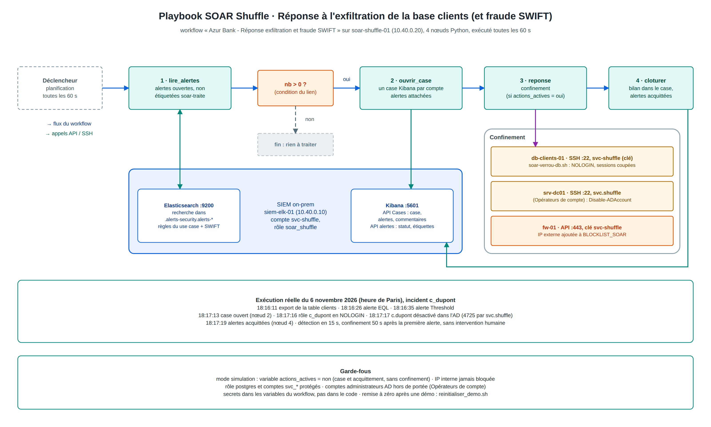

# Partie D : réponse à incident (triage, ticket 5W, playbook SOAR)

L'incident traité ici est réel sur le lab. Le 6 novembre 2026 à 18:16 (heure de Paris), le compte `c_dupont` exfiltre la
table clients depuis le bastion. Le SIEM le détecte, Shuffle confine le compte, puis un analyste trie, documente et clôt
le case dans Kibana. Capture du case : `schemas/case-kibana-c_dupont.png`. Schéma du playbook : `schemas/playbook-shuffle.png`
(source modifiable `playbook-shuffle.drawio`, régénérée par `schemas/gen_playbook.py` à partir de la structure du workflow réel).

## 1. Chronologie (heure de Paris)

| Heure | Événement | Source |
| --- | --- | --- |
| 18:16:11.493 | Première des 600 lectures `SELECT` sur `clients`, par `c_dupont`, depuis 10.0.5.10 | `logs-db.audit-*` |
| 18:16:11.680 | `COPY clients TO STDOUT` : export complet | `logs-db.audit-*` |
| 18:16:26 | Alerte « Lecture massive base clients puis export » (EQL, critique, risque 99) | `.alerts-security.*` |
| 18:16:35 | Alerte « Lecture massive base clients » (Threshold, élevée, risque 73) | `.alerts-security.*` |
| 18:17:13 | Shuffle ouvre le case « [SOAR] Exfiltration base clients - compte c_dupont » | Kibana Cases |
| 18:17:16 | Rôle `c_dupont` en `NOLOGIN` (journal `soar` de db-clients-01) | `logs-system.syslog-*` |
| 18:17:17 | Compte AD `c.dupont` désactivé, événement 4725 émis par `svc.shuffle` | `logs-system.security-*` (srv-dc01) |
| 18:17:17 | Alerte ES\|QL (critique), qui arrive après coup et ouvre un deuxième case | `.alerts-security.*` |
| 18:17:19 | Alertes passées en *Acknowledged*, étiquette `soar-traite` | Kibana Alerts |
| 18:20 | Prise en charge par l'analyste N1, triage | Kibana Cases |

Détection en 15 s après l'export, confinement 50 s après la première alerte, sans intervention humaine.

## 2. Triage dans Alerts et Cases : ce qui a été fait, et comment le refaire

1. **Security > Alerts**, filtre `kibana.alert.workflow_tags : "soar-traite"` : les trois alertes de l'incident. Pour chacune :
   *View details* > onglets *Overview* (règle, score, `user.name`, `source.ip`) et *Table* (champs bruts). L'onglet
   *Correlations* de l'alerte EQL montre les 101 événements de la séquence.
2. **Qualifier.** Même compte, même IP, une rafale de 600 lectures puis un export, à moins d'une seconde d'écart :
   l'automatisation est exclue, c'est un **vrai positif**.
3. **Vérifier le confinement.** Discover, `event.code : "4725" and winlog.event_data.TargetUserName : "c.dupont"` sur
   `logs-system.security-*`, puis le message `verrouille par Shuffle` dans les journaux de db-clients-01.
4. **Security > Cases**, case ouvert par Shuffle :
   - passer le statut à *En cours*, renommer le case, régler la sévérité sur *Critique* ;
   - ajouter les étiquettes `exfiltration`, `TA0010`, `T1530`, `PCI DSS` et `RGPD` ;
   - rattacher l'alerte ES|QL, arrivée après coup (*Add alert*), puis fermer le case en doublon avec un renvoi vers le case principal ;
   - fermer le case du test en mode simulation.
5. **Périmètre (N2).** Sur 24 h, `c_dupont` est le seul compte à avoir lu la table `clients`. Dans les journaux de fw-01,
   un seul flux sort de la base vers Internet, vers le miroir Debian : l'export est resté sur le bastion.
6. **Documenter et clore.** Ajouter le ticket 5W en commentaire, puis passer le case à *Fermé*. Comme le case synchronise
   ses alertes (*Sync alert status*), ses trois alertes passent aussi à *Closed*.

## 3. Ticket d'incident (5W), tel que publié dans le case

### Ticket d'incident (5W) - INC-2026-11-06-001

**Classement** : exfiltration de données clients, vrai positif, criticité critique (P1). MITRE ATT&CK : TA0009 Collection, TA0010 Exfiltration, T1530.

| | |
|---|---|
| **Qui (Who)** | Compte base `c_dupont` (rôle PostgreSQL en lecture seule), rattaché au compte AD `AZURBANK\c.dupont` (conseiller clientèle). Connexion depuis bastion-01 (10.0.5.10, zone ADM). |
| **Quoi (What)** | 600 `SELECT` unitaires sur `core_clients.clients`, puis un `COPY clients TO STDOUT`, soit l'export complet de la table : 5 000 fiches clients (nom, IBAN, solde). |
| **Où (Where)** | db-clients-01 (10.10.1.20, zone DC, PostgreSQL 17 + pgaudit), base `core_clients`. Seul chemin autorisé vers la base : le bastion (fw-01, zone ADM). |
| **Quand (When)** | 6/11/2026, heure de Paris. 18:16:11.493 : première lecture. 18:16:11.680 : export. 18:16:26 : alerte EQL (lecture puis export). 18:16:35 : alerte Threshold. 18:17:16 : rôle verrouillé. 18:17:17 : compte AD désactivé. 18:17:17 : alerte ES\|QL. |
| **Pourquoi / comment (Why/How)** | Usage d'un compte légitime pour collecter puis sortir la base clients en une seule session. Cause probable : identifiants du conseiller compromis, et bastion sans second facteur pour ce compte (`pam_google_authenticator nullok`). Motivation probable : revente de données bancaires (fraude au faux conseiller, hameçonnage ciblé). |

**Mesures**

- Détection (MTTD) : 15 s entre l'export et la première alerte.
- Confinement (MTTR) : 50 s entre la première alerte et le verrouillage, par le playbook Shuffle, sans intervention humaine.

**Actions menées**

1. Automatique (Shuffle) : case ouvert, rôle `c_dupont` en `NOLOGIN` et sessions coupées, compte AD `c.dupont` désactivé, alertes acquittées. L'IP source est interne (bastion), elle n'a donc pas été bloquée.
2. N1 : alertes vérifiées, vrai positif confirmé, alerte ES\|QL rattachée, case doublon fermé, escalade N2.
3. N2 : périmètre confirmé. Sur 24 h, c_dupont est le seul compte à avoir lu la table clients. Dans les journaux de fw-01, un seul flux sort de la base vers Internet, entre 18:00 et 18:40 : 151.101.206.132:80, le miroir Debian (mise à jour de paquets), sans lien avec l'incident. L'export est donc resté sur le bastion, qui devient la pièce à analyser (fichier écrit, rebond vers l'extérieur).

**Impact et obligations**

- Données personnelles et bancaires (IBAN) de 5 000 clients. Notification à la CNIL sous 72 h (RGPD, art. 33) et information des clients concernés (art. 34) si le risque est élevé.
- Pas de numéro de carte (PAN) dans la table : le périmètre PCI DSS n'est pas touché, mais l'incident est journalisé et conservé au moins un an (PCI DSS 10.5.1).
- Signalement au régulateur (ACPR / DORA, incident majeur lié aux TIC) à évaluer par le RSSI selon les critères de classification.

**Recommandations**

1. Rendre le TOTP obligatoire sur le bastion (retirer `nullok`) et changer le mot de passe de c.dupont.
2. Retirer à `c_dupont` le droit de lire toute la table : vue limitée aux clients de son agence, et pas de `COPY` pour les rôles conseillers.
3. Garder le playbook en mode réel. Ajouter une étape de mise en quarantaine du poste source via Elastic Defend (licence Platinum) ou via fw-01.

## 4. Playbook SOAR (Shuffle)

Le workflow « Azur Bank - Réponse exfiltration et fraude SWIFT » est déclenché toutes les 60 s. Une condition sur le premier
lien (`$lire_alertes.message.nb larger than 0`) l'arrête quand il n'y a rien à traiter. Le code des quatre nœuds est dans
`soar-shuffle-01/playbook/`, et `soar-shuffle-01/creer_workflow.py` recrée le workflow. Installation et comptes de service :
`../02 - Architecture et infra/INFRA.md`, section Bonus.

Pour rejouer l'incident : lancer l'exfiltration depuis le bastion (`../02 - Architecture et infra/VISITE_GUIDEE.md`, maillon 3),
attendre une minute, faire le triage ci-dessus, puis remettre le compte en état sur l'hôte avec `bash /root/soc-enroll/reinitialiser_demo.sh`.
